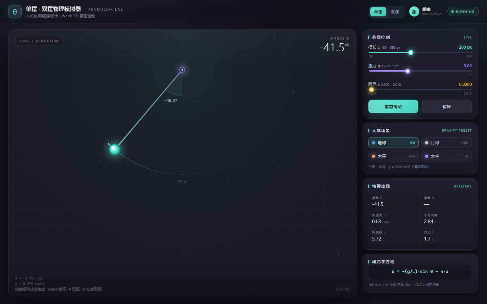
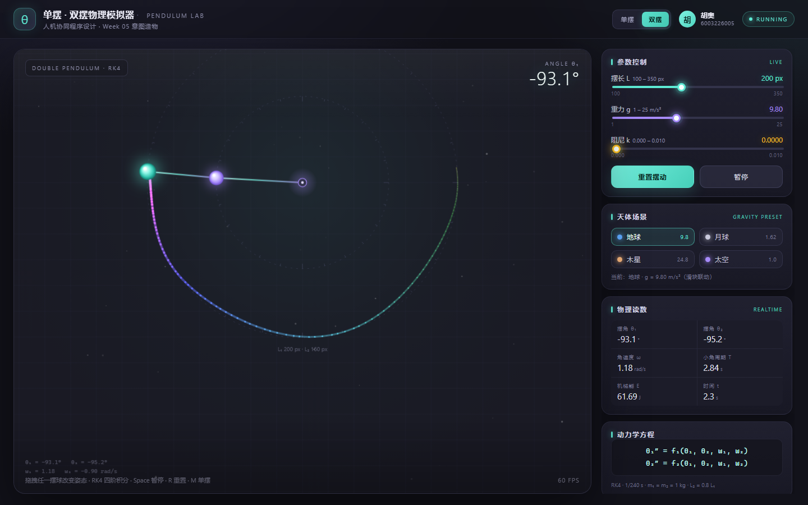
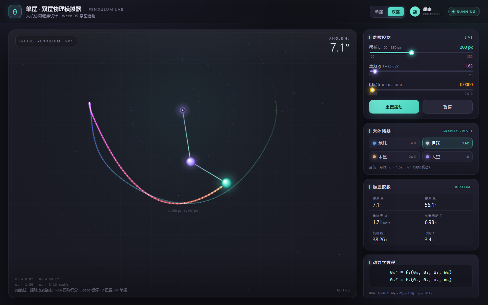
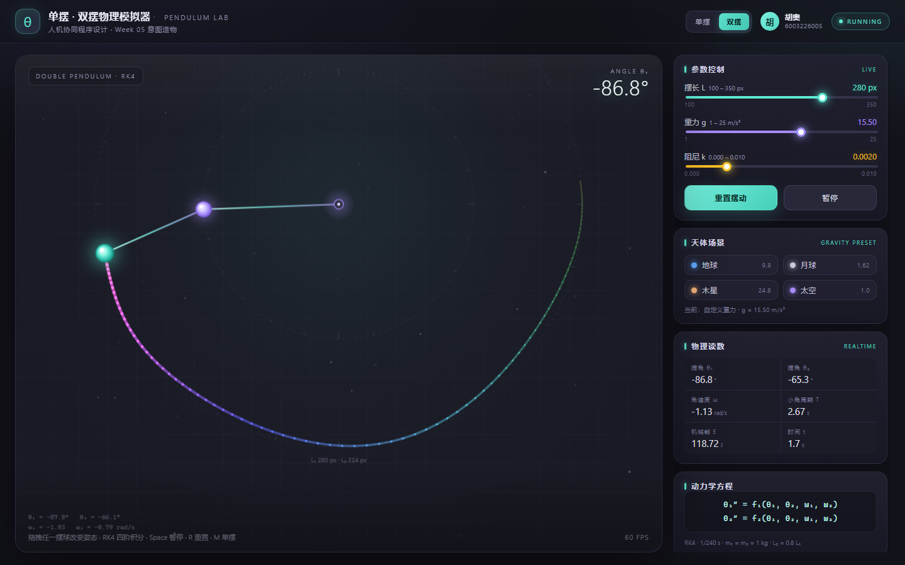

# 第 5 周实验报告 · 意图造物与 ReAct 闭环编程

> 南昌大学《人机协同程序设计》 · 个人独立上机实验（HOTL 模式）
> 从结构化意图到可运行的交互世界

| 项目 | 内容 |
| --- | --- |
| 实验者 | **胡奥** |
| 学号 | **6003226005** |
| 实验主题 | 意图驱动编程与 ReAct 自动化纠偏闭环 |
| 交付物 | `index.html`（单文件应用）+ 本报告（含人机协同三反思） |
| 无菌工作区 | `week05_pendulum_sim/`（独立 Git 仓库，本目录即仓库根） |
| 运行方式 | 双击 `index.html`，无需服务器、无需依赖、不加载任何外部资源 |

---

## 0. 一句话总结

在不手写一行纯语法代码的前提下，我用「角色 + 目标 + 约束 + 验收标准」四段式意图驱动 AI
生成了一个纯原生 Canvas 的单摆 / 双摆物理模拟器；并用浏览器控制台的真实堆栈完成了一次
ReAct 闭环自愈。最终应用 **0 控制台报错、稳定 60 FPS、参数可持久化**，并保留了 6 次可追溯的
Git 提交与完整证据链。

---

## 1. 实验完成度

| 实验任务 | 要求 | 完成情况 |
| --- | --- | --- |
| 任务一 · 环境隔离 | 创建 `week05_pendulum_sim/` 无菌目录、README、首个 Commit | ✅ 独立 Git 仓库 + 基线提交 `9202f93` |
| 任务二 · 意图造物 | 单文件 Canvas 单摆 MVP，深灰背景、发光摆球、45° 初始角 | ✅ `index.html` 单文件，零外部依赖 |
| 任务三 · 敏捷演进 | 三滑块（L / g / k）、重置按钮、实时响应、0 报错 | ✅ 100–350 px、1–25、0–0.010，实时联动 |
| 任务四 · 闭环自愈 | 捕获 Console 红字，ReAct 根因修复，回归验证 | ✅ 真实 `ReferenceError` → 0 报错，44.99° 复位 |
| 进阶 A · 双摆 | RK4、彩虹渐变拖尾、鼠标拖拽 | ✅ 双摆混沌 + 300 点彩虹拖尾 + 双球拖拽 |
| 进阶 B · 天体持久化 | 4 个天体胶囊、平滑重力、localStorage | ✅ 地球/月球/木星/太空 + 刷新恢复 |
| 交付 · Git | ≥ 3 次清晰 Commit、push 至 GitHub、Zip 打包 | ✅ 6 次提交（见 §8）；打包见根目录 Zip |

---

## 2. 无菌工作区与工程基线

本目录本身就是一个独立的 Git 仓库，避免与课程其他周的代码、缓存和构建产物互相污染：

```
week05_pendulum_sim/
├── index.html                         # 最终交付的单文件应用（约 1.1k 行，含注释）
├── README.md                          # 本报告（含人机协同三反思）
├── .gitignore                         # 忽略系统文件、日志与打包产物
├── starter_code/
│   └── 03_buggy_practice/
│       └── index.html                 # ReAct 故障演练页（修复后版本）
├── docs/
│   ├── react-console-error.txt        # 原始 Console 红字证据
│   ├── react-debug.md                 # ReAct 三轮推理与修复 Diff
│   ├── verification.md                # 自动化验收清单
│   ├── verification-report.json       # 自动化脚本原始输出
│   └── screenshots/                   # 01–13 号运行截图
└── .git/                              # 6 次规范 Commit
```

基线命令（实验第一步已实际执行）：

```bash
git init -b main
git config user.name "胡奥"
git config user.email "6003226005@ncu.edu.cn"
git add .
git commit -m "feat(week05): init pendulum experiment workspace"
```

> 设计取舍：把第 5 周做成**自包含仓库**而不是继续往课程大仓库里堆文件，交作业时可以直接
> 打包整个目录（含 `.git`），评审者无需任何环境就能看到完整演进历史。

---

## 3. 意图设计：四段式 Prompt 如何约束结果

### 3.1 单摆 MVP

| 要素 | 我写入的内容（摘要） |
| --- | --- |
| 角色 Role | 资深前端可视化与物理仿真工程师 |
| 目标 Goal | 创建单个完整 `index.html`，实现带阻尼的简谐单摆 |
| 约束 Boundary | 单文件；纯原生 Canvas；不引外部库；背景 `#1a1a24`；摆球发光；L=200 px、g=9.8、初始 45°；`requestAnimationFrame` 驱动 |
| 验收 Acceptance | 双击打开即流畅摆动；控制台 0 报错；摆球在画布垂直方向占比合理，L=350 px 时不出界 |

### 3.2 参数交互增量

| 要素 | 内容 |
| --- | --- |
| 目标 | 在现有文件上追加实时参数控制，不重写渲染层 |
| 约束 | 摆长 100–350 px、重力 1–25、阻尼 0.000–0.010；3 个滑块 + 数值标签；“重置摆动”精确回到 45°；保持深色质感 |
| 验收 | 拖动即时响应、阻尼自然衰减、重置复位、控制台 0 报错 |

### 3.3 进阶挑战

| 要素 | 内容 |
| --- | --- |
| 目标 | 双摆混沌模拟 + 天体场景与本地持久化 |
| 约束 | RK4 四阶积分；第二个摆球半透明彩虹渐变衰减拖尾；鼠标拖拽摆球；4 个天体胶囊；localStorage 自动保存/恢复 |
| 验收 | 双摆翻转无数值发散、拖尾有美感、拖拽即时响应；刷新后参数完美恢复、0 报错 |

> 关键经验：**验收标准必须是可观测的数字或行为**。写“流畅一点”没有用，写“L=350 px 时摆球不得出画布、控制台 0 红字、重置后 HUD 立即为 45.0°”，AI 才能自我校验，我也才能裁判。

---

## 4. 技术实现

### 4.1 单摆动力学

```
α = −(g / L) · sin θ − k · ω
```

- **像素—米换算**：`100 px = 1 m`。摆长滑块以 px 存储，物理计算时换算为米，保证
  `g = 9.8` 时 L=200 px 的小角周期约 **2.84 s**，视觉节奏自然。
- **阻尼量纲标定**：滑块 `k` 采用实验指导书的 0–0.010 量级；若直接作为连续时间系数，
  `k = 0.010` 时时间常数 100 s，几乎看不到衰减。因此按 **40×** 换算为连续阻尼
  （`k_eff = 40k`），最大档时间常数约 2.5 s，既保留原量纲又让“阻尼自然衰减”可被肉眼验收。
- **固定步长积分**：物理以 `1/240 s` 固定步长推进，渲染用 `requestAnimationFrame`。
  高刷屏（120/144 Hz）与 60 Hz 屏幕下摆速一致，不会出现“换台电脑就变快”的漂移。
- **机械能**：单摆按单位质量计算；双摆取 `m₁ = m₂ = 1 kg`，因此读数单位为 J。

### 4.2 交互与状态

- 三个滑块均带实时数值标签、渐变轨道与键盘可访问性（`aria-label`）。
- 「重置摆动」单摆精确回到 **45°**，双摆回到 **100° / 90°** 标准姿态，同时清零角速度、时间与拖尾。
- 「暂停 / 继续」冻结物理但保留渲染；空格快捷键同效。
- 鼠标 / 触控拖拽摆球：按下即冻结并清零角速度，移动时按 `atan2` 反解角度，释放后从新姿态继续。
- `Space` 暂停、`R` 重置、`M` 切换单/双摆（输入控件聚焦时不拦截）。

### 4.3 进阶 A：双摆 RK4

采用标准双摆耦合方程（两质点、无质量刚性杆，`L₂ = 0.8 L₁`）：

```
θ̈₁ = [−g(2m₁+m₂)sinθ₁ − m₂g sin(θ₁−2θ₂) − 2m₂ sin(θ₁−θ₂)(ω₂²L₂ + ω₁²L₁cos(θ₁−θ₂))]
      / [L₁(2m₁+m₂−m₂cos(2θ₁−2θ₂))]

θ̈₂ = [2 sin(θ₁−θ₂)(ω₁²L₁(m₁+m₂) + g(m₁+m₂)cosθ₁ + ω₂²L₂m₂cos(θ₁−θ₂))]
      / [L₂(2m₁+m₂−m₂cos(2θ₁−2θ₂))]
```

- 用 **RK4** 四阶积分推进 `[θ₁, ω₁, θ₂, ω₂]`，固定步长 1/240 s；
- 每步对角度做 `atan2(sin, cos)` 归一化，避免长时间运行后数值膨胀；
- 第二个摆球维护 300 点拖尾，按时间与索引叠加 **HSL 彩虹色相 + 透明度衰减**，使用
  `globalCompositeOperation = 'lighter'` 形成半透明发光尾迹；
- 拖拽第一颗球时同步旋转 `θ₂`，保持双摆相对构型；拖拽第二颗球则直接反解 `θ₂`。

### 4.4 进阶 B：天体场景与持久化

| 天体 | g (m/s²) | 说明 |
| --- | --- | --- |
| 地球 | 9.80 | 基准场景 |
| 月球 | 1.62 | 慢速、长周期 |
| 木星 | 24.80 | 快速、强耦合 |
| 太空 | 1.00 | 滑块下限内的微重力演示 |

- 点击胶囊后用 620 ms 的 easeInOut 补间平滑改变重力，并实时回写滑块与数值标签；
- 用户手动拖动重力滑块时，预设高亮自动切换为「自定义重力」；
- `localStorage` 键：`week05.pendulum.v1`，保存 `{ mode, L, g, k, preset }`；
- 读取时对范围、类型、模式做校验，损坏缓存 / 隐私模式异常均静默降级，不产生控制台错误；
- `pagehide` 与页面隐藏时兜底保存，避免只依赖 250 ms 防抖计时器。

### 4.5 渲染细节

- 所有绘制在单个 `<canvas>` 内完成：星空、网格、测量圆环与刻度、角度扇形、渐变摆杆、
  径向渐变发光摆球；双摆第一球为紫色、第二球为青绿色，便于区分。
- 按 `devicePixelRatio`（上限 2）缩放 backing store，`ctx.setTransform` 保持 CSS 像素坐标，
  高分屏不模糊、不产生累计误差。
- `ResizeObserver` 监听舞台尺寸，窗口缩放时重新计算悬挂点与自适应比例，摆长 350 px 也不出画布。
- 自适应比例：单摆 `fit = min(1.55, 可用高度/350)`；双摆 `fit = min(0.95, 可用高度/630)`，
  并下移悬挂点，为双摆的上翻预留空间。

---

## 5. ReAct 闭环自愈实录

### 5.1 真实报错（原文）

点击故障演练页「重置摆动」后，Console 捕获：

```
Uncaught ReferenceError: resetAnimation is not defined
    at onclick (file:///D:/3/week05_pendulum_sim/starter_code/03_buggy_practice/index.html:34:56)
    at (anonymous) (:1:37)
```

完整证据：[`docs/react-console-error.txt`](docs/react-console-error.txt)。

### 5.2 三轮 ReAct

| 轮次 | Thought | Action | Observation |
| --- | --- | --- | --- |
| 1 | 先定位，不重写。`ReferenceError` 说明标识符不在查找链上 | F12 → Console 复现，复制完整堆栈；检查第 34 行与 `<script>` | 行内 `onclick` 调用全局函数；函数却定义在 IIFE 内；动画循环正常 |
| 2 | 行内事件在全局作用域解析，IIFE 局部函数不可见；属于绑定方式与封装方式不匹配 | 设计最小修复：删除行内 `onclick`，在 IIFE 内 `addEventListener` | 只改 5 行，物理与渲染零改动 |
| 3 | 必须回归验证，不能“看起来好了” | 无头 Edge 重新加载，点击暂停/重置，像素反推摆角 | 异常 0 条；按钮文案切换；摆角 **44.99°** |

### 5.3 根因与修复

| 层次 | 结论 |
| --- | --- |
| 直接原因 | 行内 `onclick` 在全局作用域查找 `resetAnimation`，而它是 IIFE 的局部函数 |
| 深层原因 | 新增按钮时复制了旧式 `onclick` 写法，未同步导出函数；事件绑定与代码封装方式冲突 |
| 为什么动画没坏 | 动画由 IIFE 内部的 `requestAnimationFrame(frame)` 驱动，不经过全局查找 |
| 为什么不用 `window.resetAnimation = ...` | 能消除报错，但把内部实现暴露成全局副作用，掩盖问题而非修复问题 |

```diff
- <button id="resetBtn" onclick="resetAnimation()">重置摆动</button>
- <button id="pauseBtn" onclick="togglePause()">暂停</button>
+ <button id="resetBtn" type="button">重置摆动</button>
+ <button id="pauseBtn" type="button">暂停</button>

+ document.getElementById('resetBtn').addEventListener('click', resetAnimation);
+ document.getElementById('pauseBtn').addEventListener('click', togglePause);
```

详细推理与“情绪化反馈 vs 证据驱动反馈”对照见 [`docs/react-debug.md`](docs/react-debug.md)。

---

## 6. 验收证据

自动化验收使用 Edge headless + CDP：监听 `Runtime.exceptionThrown`、`consoleAPICalled`、
`Log.entryAdded`，用真实 `Input.dispatchMouseEvent` 拖拽摆球，视口 1440×900。

| 验收项 | 结果 |
| --- | --- |
| 控制台异常 / console.error | **0 / 0** |
| 帧率 | **60 FPS** |
| 滑块联动 | L=330、g=21.5、k=0.006 → 周期 2.46 s ✅ |
| 重置精度 | HUD **45.0°**；演练页像素反推 **44.99°** |
| 拖拽 | 状态进入 `DRAGGING`，释放后恢复 ✅ |
| 双摆 | 连续运行 2 s+ 无 NaN、能量守恒（61.69 J）✅ |
| 天体预设 | 月球 1.62、滑块与标签同步 ✅ |
| 持久化 | L=280 / g=15.5 / k=0.002 / 双摆，刷新后完整恢复 ✅ |

| 单摆主界面 | 双摆混沌 + 彩虹拖尾 |
| --- | --- |
|  |  |

| 月球预设 | 刷新后恢复自定义参数 |
| --- | --- |
|  |  |

更多截图见 `docs/screenshots/`，完整验收说明见 [`docs/verification.md`](docs/verification.md)。

---

## 7. 人机协同三反思

### 7.1 意图清晰度反思：哪一次结果不符合预期？缺了哪一项？

最典型的一次不是“代码跑不起来”，而是**第一版 MVP 的构图失衡**：在约 1400×750 的画布里，
200 px 的摆线只占画布高度的约四分之一，摆球停在画面中上部，下半幅留下大片空白。回看当时的
提示词，我写了“摆长 L=200px、背景 #1a1a24、摆球发光、45° 初始角”，但**没有写视觉验收
标准**——没有约束摆长与画布高度的比例，也没有说明 px 与物理米的换算。AI 严格按字面执行，
物理是对的，画面却不像一个“作品”。第二次我把验收标准改成可测量的三条：L=200 px 时摆球
中心超过画布高度的一半；L=350 px 时不得出界；控制台 0 报错。并补充边界条件：
`100 px = 1 m`、自适应 `fit` 缩放、双摆悬挂点下移。补上这些之后，同一句“单摆模拟器”才
长出可交付的形态。

还有一次很小的“不精确”：点击重置后 HUD 显示 43.6° 而不是 45°。代码把角度设成了 45°，但读数
每 80 ms 才节流刷新一次，重置瞬间没有强制刷新。我给 `updateReadouts` 加了 `force` 参数并在
重置路径调用，读数才立即变成 45.0°。这两次让我确认：**验收标准缺失或模糊时，AI 不会“领会
精神”，只会忠实执行字面；人必须把“好”翻译成可观察的数字与行为。**

### 7.2 闭环控制反思：如何定位？是否看懂了修复？

遇到报错时，我先做证据采集，而不是让 AI “重写一遍”。F12 打开 Console，点击重置，复制完整
堆栈：`ReferenceError: resetAnimation is not defined at onclick (index.html:34:56)`。这条堆栈
给了两个关键信息：错误类型是 `ReferenceError`（标识符查找失败，排除语法错误和物理计算）；
位置在 `HTMLButtonElement.onclick`（排除动画循环，锁定事件回调）。再结合“动画还在动、只有
按钮失效”，范围就缩到事件绑定与作用域。

AI 给出的修复不是删掉报错，而是解释清楚：行内 `onclick` 的属性值在**全局作用域**执行，而
`resetAnimation` 被 IIFE 封装成局部函数，二者不在同一条作用域链上。因此正确的修法是删除行内
`onclick`，在 IIFE 内部用 `addEventListener` 绑定——既保留封装，也不污染 `window`。我特意
没有采用“把函数挂到 `window` 上”的捷径，因为它只是让报错消失，副作用和同类问题仍在。修复后
我用像素反推摆角得到 **44.99°**，确认不是“看起来好了”。

物理层也有一次“看懂了才算修好”：最初把滑块 `k` 直接当作 `α = −kω` 的系数，`k = 0.010` 时
几乎看不到衰减。理解量纲后才知道实验指导书的 k 更接近“每帧”系数，于是按 40× 换算成连续时间
阻尼，并改用 1/240 s 固定步长，避免高刷屏下周期漂移。**看懂修复的关键，是能指出它改的是
哪条边界条件（作用域边界 / 时间步长 / 量纲），而不是只看结果能不能跑。**

### 7.3 主体地位确认：哪些是我决定的？哪些是 AI 完成的？

作为 HOTL 中的产品总设计师，我决定的是**边界与正确性**：单文件、零依赖、离线双击可运行；
深灰科技底 + 青绿/紫的视觉语言；功能优先级（先单摆 MVP，再滑块，最后双摆与天体）；验收阈值
（0 报错、60 FPS、重置 45°、L=350 不出界、刷新恢复参数）；以及拒绝“把函数挂到 window”这类
掩盖问题的方案。双摆是否采用 RK4、第二颗球用彩虹拖尾、持久化存哪些字段，也都是我先定方案，
AI 再实现。

AI 承担的是**高频重复劳动**：Canvas 绘制与发光效果、CSS 布局与响应式、滑块与事件绑定样板、
RK4 公式转录、localStorage 读写、无头浏览器验收脚本与截图。它写得比我手敲快得多，也会主动
补齐异常处理（例如 `try/catch` 包裹 localStorage）。

但主体地位不等于“人只写需求”。我必须能读懂它改的作用域、能判断阻尼量纲是否合理、能识破
“把报错藏起来”的假修复，才有资格做质量裁判。**HOTL 的核心不是人和 AI 分工写代码，而是人
保留定义正确性、验收结果和承担后果的权力。**

---

## 8. Git 提交历史

| # | Commit | 说明 |
| --- | --- | --- |
| 1 | `9202f93` | `feat(week05): init pendulum experiment workspace` |
| 2 | `030a7db` | `feat: complete pendulum MVP with glowing canvas render` |
| 3 | `7a18bee` | `feat: add interactive parameter sliders and reset control` |
| 4 | `46adde7` | `fix: resolve reset button runtime error` |
| 5 | `58ae813` | `feat: add double pendulum RK4, celestial presets and persistence` |
| 6 | 本次提交 | `docs: complete experiment report and human-AI reflections` |

查看完整历史：

```bash
git log --oneline --graph --decorate
```

---

## 9. 远端同步（GitHub）

本机实验环境未保存 GitHub 账号凭据，因此远端推送需要实验者本人授权后执行一次。本地仓库、
提交历史与打包文件均已就绪：

```bash
# 在 GitHub 新建空仓库 week05-pendulum-sim 后：
git remote add origin https://github.com/<你的GitHub用户名>/week05-pendulum-sim.git
git push -u origin main
```

> 推送完成后，将本节的 `<你的GitHub用户名>` 替换为实际地址即可形成作品集链接。
> 仓库内已包含 `.git/` 完整历史，评审者可直接 `git log` 复核 6 次提交。

---

## 10. 已知限制与可继续演进

1. **file:// 下的 localStorage**：Chromium 允许，但部分浏览器隐私模式会抛异常；代码已用
   `try/catch` 静默降级，功能不受影响，只是不持久化。
2. **双摆极端姿态**：L=350 px 且大幅上翻时，第一颗球可能短暂贴近画布上边缘；已通过下移
   悬挂点和 0.95 的缩放上限缓解，未做完全贴边裁切。
3. **能量漂移**：RK4 在 1/240 s 下能量误差很小（长时间运行可观察到缓慢漂移），未加入能量
   重归一化；若要长时间演示可补辛积分或能量修正。
4. **可继续做**：相空间轨迹图、能量—时间曲线、双摆参数（m₁/m₂、L₂）独立滑块、录屏导出。

---

## 附录：文件与截图索引

| 文件 | 用途 |
| --- | --- |
| `index.html` | 最终单文件应用（单摆 + 双摆 + 天体 + 持久化） |
| `starter_code/03_buggy_practice/index.html` | ReAct 故障演练页（修复后） |
| `docs/react-console-error.txt` | 修复前真实 Console 堆栈 |
| `docs/react-debug.md` | ReAct 三轮推理、根因、Diff、反馈质量对照 |
| `docs/verification.md` | 自动化验收清单与复现步骤 |
| `docs/verification-report.json` | 验收脚本原始输出 |
| `docs/screenshots/01_mvp.png` | MVP 首轮 |
| `docs/screenshots/02_sliders.png` | 滑块界面 |
| `docs/screenshots/03_params.png` | 参数极值组合 |
| `docs/screenshots/04_drag.png` | 单摆拖拽 |
| `docs/screenshots/05_running.png` | 阻尼运行 |
| `docs/screenshots/06_practice_before.png` | 故障页修复前 |
| `docs/screenshots/07_practice_error.png` | 故障页报错现场 |
| `docs/screenshots/08_practice_fixed.png` | 故障页修复后 |
| `docs/screenshots/09_single_final.png` | 最终单摆 |
| `docs/screenshots/10_double_chaos.png` | 双摆混沌 + 彩虹拖尾 |
| `docs/screenshots/11_moon_preset.png` | 月球预设 |
| `docs/screenshots/12_restored.png` | 刷新后恢复自定义参数 |
| `docs/screenshots/13_double_drag.png` | 双摆拖拽 |

---

*实验者签名：胡奥　学号：6003226005*
